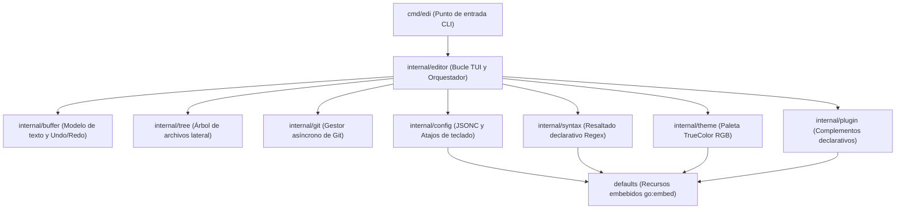

# Arquitectura Técnica de edi

Este documento describe la arquitectura interna, diseño de módulos, concurrencia y flujo de datos de **edi**.

---

## 1. Visión General del Sistema

`edi` está construido siguiendo una arquitectura modular basada en paquetes desacoplados dentro de `internal/`. Cada subsistema tiene una única responsabilidad bien definida:



---

## 2. Descripción de Subsistemas y Paquetes

### `cmd/edi`
- **Responsabilidad**: Punto de entrada del binario ejecutable.
- **Funcionalidad**:
  - Parsea banderas de línea de comandos (`-h`, `--help`, `-v`, `--version`, `--init`, `--config-dir`).
  - Inicializa la pantalla de terminal mediante `tcell.NewScreen()`.
  - Carga la configuración del usuario y resuelve el archivo o directorio a abrir.
  - Instancia `editor.NewEditor` e inicia el ciclo principal.

### `internal/buffer`
- **Responsabilidad**: Estructura de datos para el contenido del documento, historial y cursor.
- **Estructura principal**: `Buffer`
  - `Lines []string`: Array dinámico de líneas UTF-8 indexadas en memoria.
  - `CursorRow`, `CursorCol`: Posición del cursor en coordenadas de documento (0-indexed).
  - `history []BufferSnapshot`: Historial multinivel para operaciones de Deshacer (`Ctrl+Z`) y Rehacer (`Ctrl+Y`).
  - `Modified bool`: Bandera que indica si el documento tiene cambios pendientes de guardar.
  - `MoveLinesUp(start, end)`, `MoveLinesDown(start, end)`: Reordenamiento atómico de líneas individuales o bloques seleccionados.

### `internal/editor`
- **Responsabilidad**: Orquestador principal, renderizado gráfico en terminal y captura de eventos.
- **Componentes clave**:
  - **Bucle de renderizado (`Draw`)**:
    1. Renderiza la barra superior de pestañas (`drawTabs`).
    2. Si el panel lateral está activo, renderiza el árbol jerárquico (`drawSidebar`).
    3. Renderiza las líneas del buffer activo con numeración y resaltado de sintaxis (`drawEditor`).
    4. Si hay un modal activo (`PromptPalette`, `PromptFileFinder`, `PromptSaveAs`, etc.), lo dibuja superpuesto en el centro (`drawPaletteModal`, `drawFileFinderModal`).
    5. Renderiza la barra inferior de estado con información de Git y posición (`drawStatusBar`).
    6. Llama a `Screen.Show()` para volcar el búfer a la terminal.
  - **Gestor de Buffers**: Soporta múltiples pestañas concurrentes (`Buffers []*buffer.Buffer`), conmutación por índice o búsqueda, y buffers virtuales sin archivo asociado en disco (e.g., visores de Diff y Ayuda).
  - **Buscador de Archivos (`file_finder.go`)**: Escaneo inteligente del workspace (`ScanWorkspaceFilesDir`) con filtro difuso (*fuzzy search*) en memoria.

### `internal/git`
- **Responsabilidad**: Integración nativa con repositorios Git sin dependencias externas ni CGO.
- **Mecanismos clave**:
  - `FindRepoRoot`: Detección hacia arriba del directorio `.git`.
  - `queryGitStatus`: Ejecuta `git status --porcelain=v1 -uall` y `git branch --show-current`.
  - **Concurrencia thread-safe**: Almacena el snapshot bajo `sync.RWMutex`.
  - `RefreshAsync`: Dispara consultas asíncronas en goroutines en segundo plano. Cuando finaliza, notifica al editor mediante `Screen.PostEvent(tcell.NewEventInterrupt(nil))`, provocando un redibujado instantáneo sin bloquear la interacción del usuario.

### `internal/tree`
- **Responsabilidad**: Árbol jerárquico interactivo del sistema de archivos (`Ctrl+B`).
- **Mecanismos**:
  - `TreeNode`: Nodo con estado expandido/colapsado (`Expanded`), profundidad (`Depth`) y tipo (`IsDir`).
  - Creación directa de archivos con las teclas `a` o `n`.
  - Expansión/colapso con `Enter`, `→` y `←`.

### `internal/syntax`
- **Responsabilidad**: Resaltado de sintaxis declarativo mediante expresiones regulares compiladas.
- **Estructura**:
  - `SyntaxDef`: Definición de lenguaje basada en JSON (extensiones y lista de reglas por *scope*).
  - `HighlightLine`: Tokeniza una línea y retorna los estilos correspondientes sin depender de analizadores léxicos pesados en C.

### `internal/theme`
- **Responsabilidad**: Motor de estilos TrueColor (24 bits) en formato JSON.
- **Temas base**: `dracula.json` y `monokai.json`.
- **Estructura**: Define colores HEX para elementos de interfaz (`background`, `foreground`, `selection`, `cursor_line`, etc.) y sintaxis (`keyword`, `string`, `comment`, `type`, `function`).

### `internal/config`
- **Responsabilidad**: Carga jerárquica de configuración y atajos de teclado.
- **Orden de resolución**:
  1. `./.edi-config/` (específico del proyecto).
  2. `~/.edi-config/` (raíz del usuario).
  3. `~/.config/edi/` (estándar XDG).
  4. `defaults/` (embebidos en el binario).
- `StripJSONComments`: Parser de JSONC que descarta comentarios estilo `//` y `/* */` antes de deserializar.

### `internal/plugin`
- **Responsabilidad**: Extensibilidad declarativa para conectar formateadores y herramientas externas.
- **Hooks soportados**:
  - `on_save`: Ejecuta herramientas como `gofmt`, `prettier` o `black` interceptando el búfer mediante tuberías (`pipe_buffer`) al guardar (`Ctrl+S`).

---

## 3. Concurrencia y Ciclo de Eventos

El bucle interactivo de `edi` se basa en captura de eventos dirigida por interrupciones:

```text
[ Terminal Event Loop ] ── PollEvent() ──► HandleEvent(ev)
         ▲                                       │
         │                                       ▼
    Screen.Show() ◄────── Draw() ◄────── [ Mutación de Estado ]
         ▲                                       │
         │                                       ▼
  EventInterrupt ◄── [ Goroutine Git / Worker en Segundo Plano ]
```

1. **Sin sondeo activo (*No Polling*)**: El hilo principal duerme en `Screen.PollEvent()` esperando pulsaciones de teclas o redimensionamiento. Cero uso de CPU en reposo.
2. **Despertar asíncrono (*Reactive Wakeup*)**: Cuando una tarea en segundo plano (como el estado de Git) completa su trabajo, emite un `tcell.NewEventInterrupt(nil)` que despierta inmediatamente a `PollEvent()`, refrescando la UI sin retrasos perceptibles.
